# Part 1 - Docker container image

### Website Content

Small static website with a home page to fill the requirements

- [index.html](web-content/index.html) - home page with a link to "other" page
- [other.html](web-content/other.html) - "other" sample page
- [style.css](web-content/style.css) - stylesheet

### Dockerfile

[Dockerfile](Dockerfile) builds an Apache server image that serves the website.

- `FROM` sets the base image
- `COPY` puts the site into a default httpd web folder `/usr/local/apache2/htdocs`

### Building the Image

From the root folder:
```bash
docker build --platform linux/amd64 -t malakhovtsev/ceg3120-cicd:latest .
```

- `-t` -tags the image
- `--platform linux/amd64` is needed to build for x86 servers on AWS (since my machine is ARM MacBook its incompatible by default)

Login with Personal Access Token (PAT) that can be created in settings on Docker Hub.

```bash
docker login -u malakhovtsev
docker push malakhovtsev/ceg3120-cicd:latest
```

DockerHub Repository: https://hub.docker.com/r/malakhovtsev/ceg3120-cicd

### Running the Container

Pull the image from DockerHub and run it:
```bash
docker pull --platform linux/amd64 malakhovtsev/ceg3120-cicd:latest
docker run -d --platform linux/amd64 --name cicd-site -p 8080:80 malakhovtsev/ceg3120-cicd:latest
```

- `-d` runs container in the background
- `-p 8080:80` maps port 8080 on local computer to port 80 in the container (where Apache listens)
- `--platform linux/amd64` is needed to build for x86 servers on AWS (since my machine is ARM MacBook its incompatible by default)

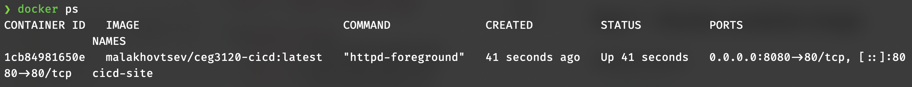
> `docker ps` shows the `cicd-site` container running from the DockerHub image with port 8080 mapped to 80

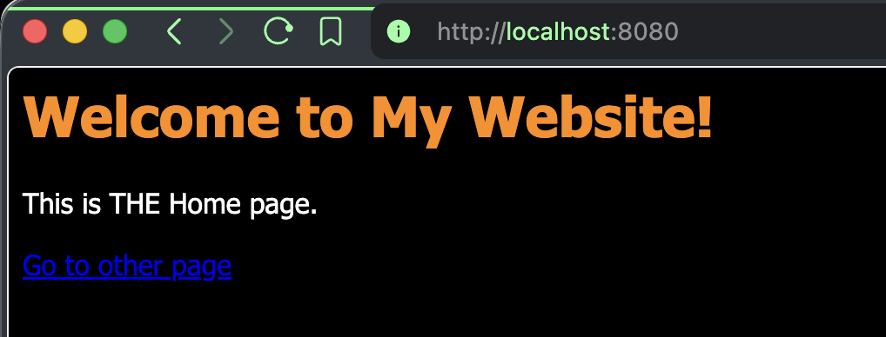
> Home page is served my the container on the port 8080, as seen in the browser, with stylesheets applied

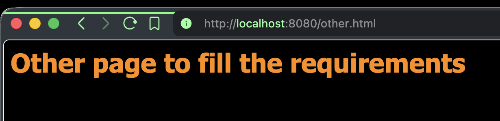
> Second required page also loads with CSS applied

# Part 2 - GitHub Actions and DockerHub

### Repository secrets

#### To create new PAT:
1. Click on the profile icon in the top right
2. Click `Account settings`
3. On the left sidebar click `Personal access tokens`
4. Click `Generate new token`
5. Enter **name**, expiration date I set as 90 days since it is a course repository (so it does expire at some point)
6. Repository permissions: `Repo Read & Write` for needed access.

#### To setup repository secrets:
1. On the repository on GitHub click `Settings` on the top panel.
2. In `Secrets and variables` section click `Actions`.
3. Click `New repository secret`.
4. Enter according name and enter/paste the secret.

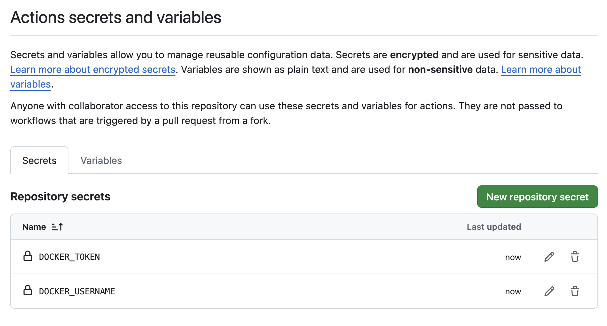
> Secrets visible no the secrets page on GitHub repository settings

- `DOCKER_TOKEN` is for personal access token allowing to login to DockerHub.
- `DOCKER_USERNAME` is the username of Docker account to know who to connect from to DockerHub.

### Workflow Trigger
Workflow runs only when commit is pushed to `main` branch:

```yaml
on:
  push:
    branches:
        - main
```

### Workflow Steps
Workflow runs `build` job:
1. Sign in DockerHub: `docker/login-action@v4`
2. Logs into DockerHub with `DOCKER_USERNAME` and `DOCKER_TOKEN` GitHub repository secrets.
3. Builds and pushes Docker image: `docker/push-action@v7` builds the image from the repository's Dockerfile and pushes it to DockerHub as hardcoded `malakhovtsev/ceg3120-cicd:latest`.

### Setup: Values to Change for Another Repository
[Part 2 workflow file (permalink)](https://github.com/WSU-kduncan/ceg3120-cicd-malakhovtsev2-f26/blob/a4794af35cad3ed2dc9733249e3d808c24b615d6/.github/workflows/docker-build.yml)

#### In the workflow file
- change hardcoded `tags: malakhovtsev/ceg3120-cicd:latest` to own `<dockerhub-username>/<repository>:<tag>`.
- if repository has different main/CI branch, change `branches: - main` to a branch name accordingly
- Secrets: `secrets.DOCKER_USERNAME` and `secrets.DOCKER_TOKEN` can be changed if repository has different secrets name.

#### In the repository
- Create secrets `DOCKER_USERNAME` and `DOCKER_TOKEN` with own DockerHub username and PAT.
- Create DockerHub repository for the Docker image.
- Create/keep workflow file in `.github/workflows/` for GitHub.

### Testing & Validating
#### Testing that workflow does its job:
1. Push any commit to `main` branch
2. Open **Actions** tab on the repository on GitHub. Run for that commit should have a green checkmark.
3. On DockerHub, the `latest` tag should have the latest push time recent accordingly to the push time.

#### Testing that Docker image works
DockerHub repository: https://hub.docker.com/repository/docker/malakhovtsev/ceg3120-cicd
```bash
docker pull --platform linux/amd64 malakhovtsev/ceg3120-cicd:latest
docker run -d --platform linux/amd64 --name cicd-site -p 8080:80 malakhovtsev/ceg3120-cicd:latest
```

### Main trigger
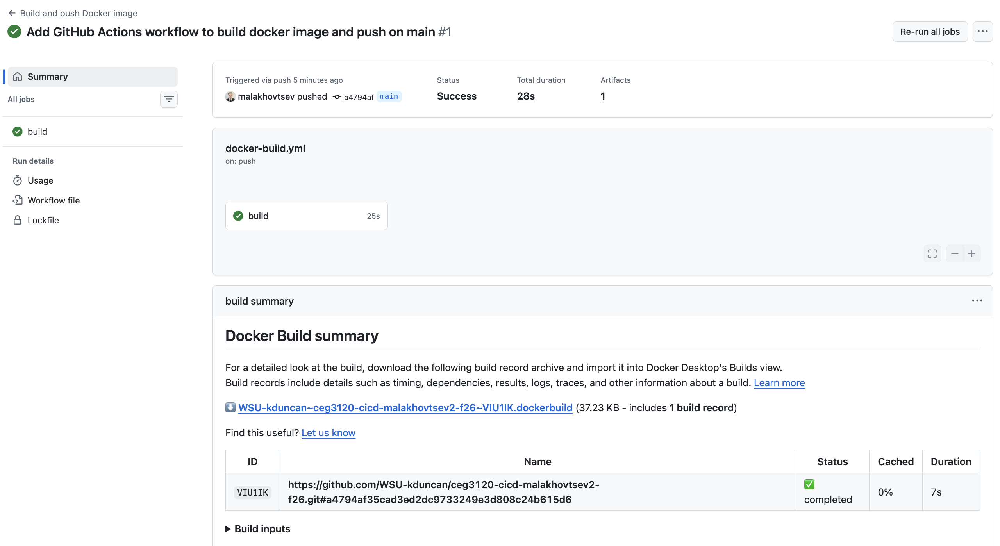
> Workflow run trigger by a push to `main` that is completed successfully.

### Branch negative test

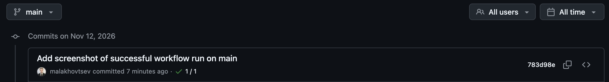
> Latest commit on `main` branch has green check showing the CI job is working

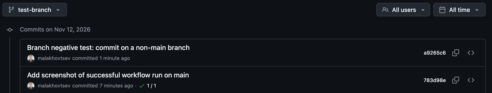
> No green checkmark on a `test-branch` on a commit confirms the CI job only runs on `main` branch

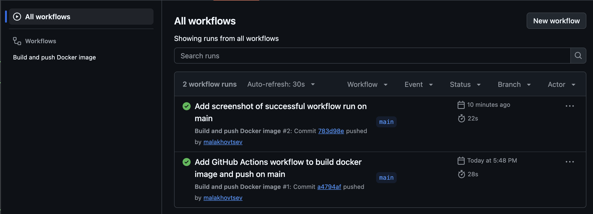
> No workflow started on `test-branch` as required

### Change to Docker image

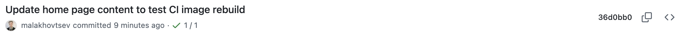
> Updated text in the web-content and committed and pushed to `main`, confirmed with green check on a commit

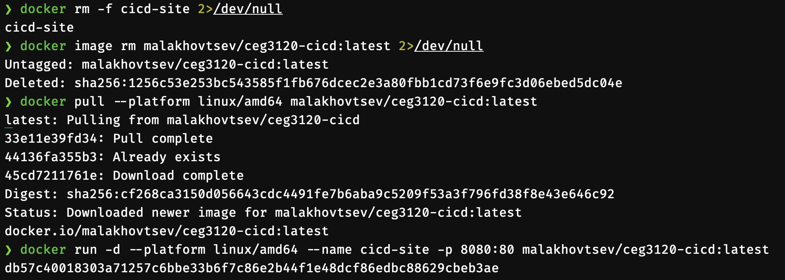
> After removing old image, `docker pull` shows that it downloaded newer image confirming workflow pushed updated image to DockerHub

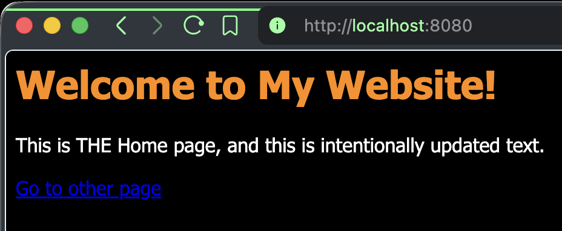
> Container from updated pulled image has the updated content, as visible with updated text in the browser, confirming the image is updated by CI workflow

# Part 3 - Semantic Versioning

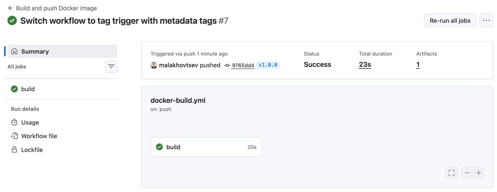

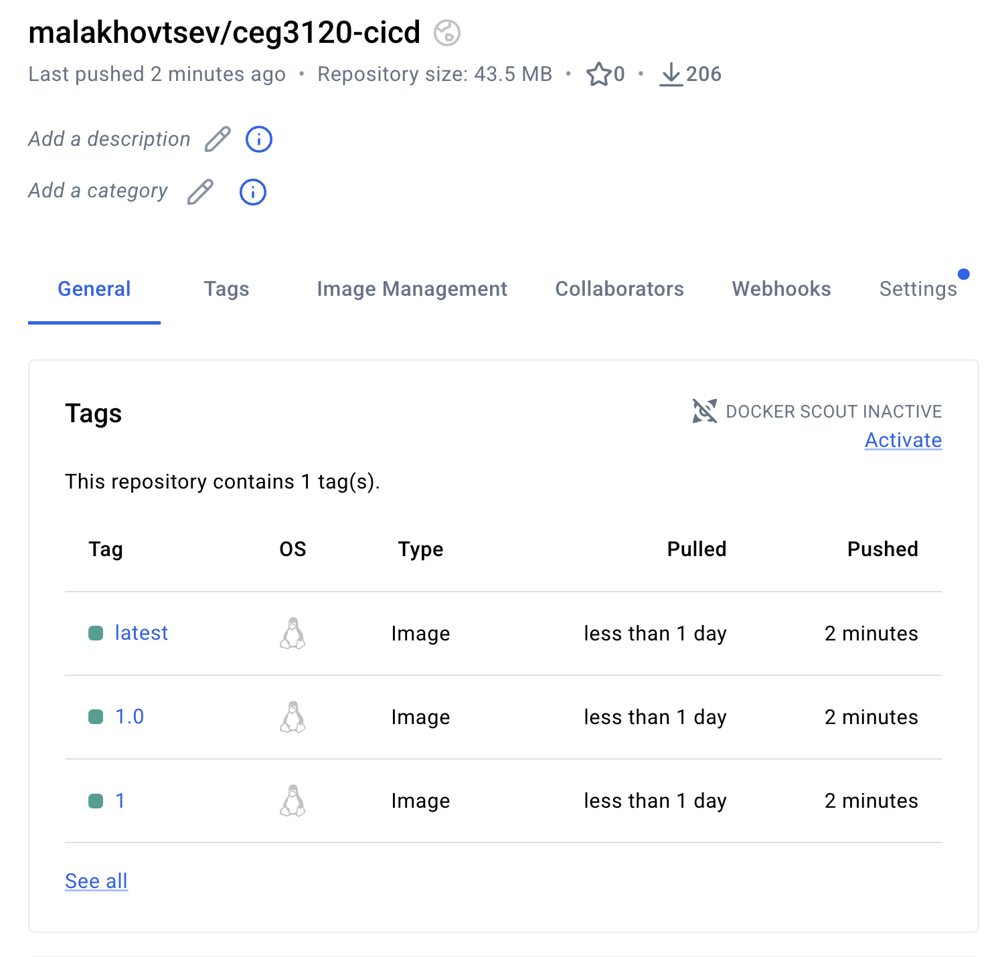


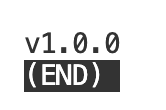

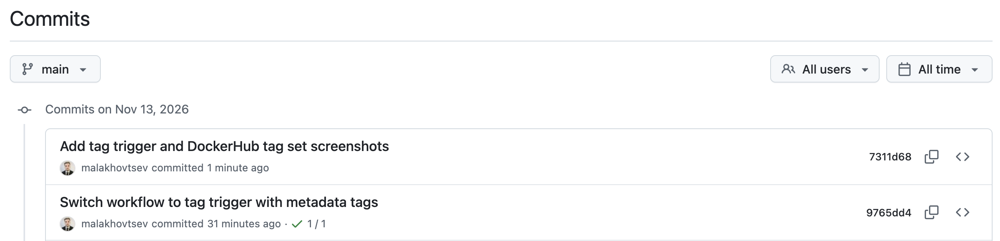
> Tag negative commit. As visible, the commit to `main` after previous tagged one did not trigger the workflow